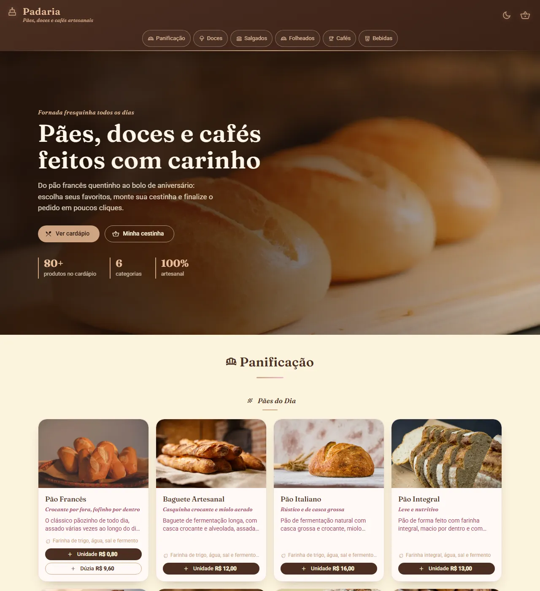
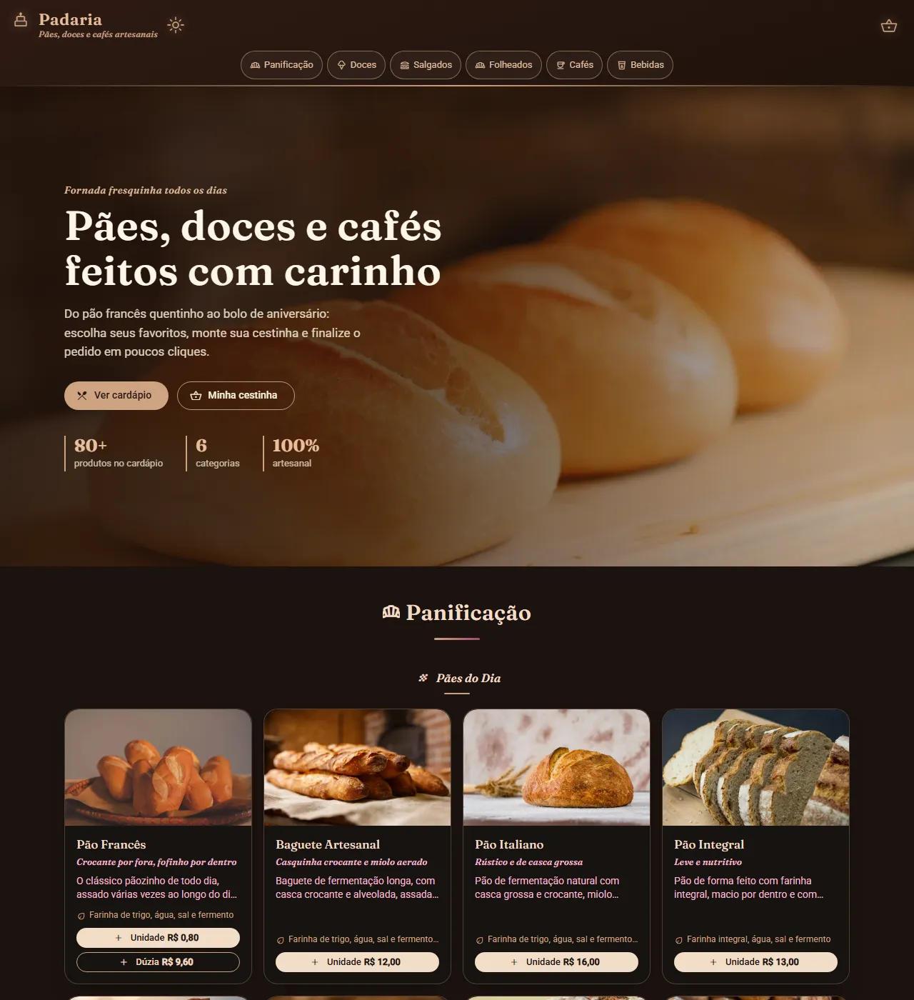

# Padaria — Landing Page

[](https://github.com/MariaClaraCorecha/landigpage-padaria/actions/workflows/ci.yml)

Cardápio online de uma padaria artesanal, com mais de 80 produtos em 6 categorias, escolha de sabores, cestinha de pedidos e recibo. Feito com **Angular 21** e **Angular Material 3**.

**Demo:** https://mariaclaracorecha.github.io/landigpage-padaria/

| Tema claro                             | Tema escuro                              |
| -------------------------------------- | ---------------------------------------- |
|  |  |

## Funcionalidades

- Cardápio por categorias (panificação, doces, salgados, folheados, cafés e bebidas)
- Preço por unidade, fatia, dúzia ou cento, com seleção de um ou vários sabores
- Cestinha com ajuste de quantidade, total e recibo do pedido
- Cestinha salva no navegador: continua lá depois de recarregar a página
- Tema claro e escuro, seguindo a preferência do sistema e lembrando a escolha
- Menu fixo que destaca a categoria visível na tela
- Layout responsivo, do celular ao desktop

## Decisões técnicas

- **Standalone components + signals**: estado do carrinho e do tema em `signal`/`computed`, persistidos com `effect`.
- **Zoneless + `OnPush`** nos componentes repetidos (cards e subseções), reduzindo o trabalho de detecção de mudanças com 80+ cards na tela.
- **Lazy loading** da página da cestinha (`loadComponent`).
- **Imagens otimizadas**: as fotos foram convertidas de JPG para WebP com no máximo 800 px de largura, passando de **77 MB para 3,3 MB** (≈ 95% menor), com `loading="lazy"` e `decoding="async"`.
- **Fonte de ícones sob medida**: o Material Symbols é baixado só com os ícones usados (`icon_names`), em vez da fonte completa.
- **Rolagem leve**: a navegação mede a posição das seções no máximo uma vez por frame (`requestAnimationFrame`).
- **Tema com tokens CSS**: cores definidas como variáveis em `:root` e redefinidas em `[data-theme='dark']`; um script inline aplica o tema antes do Angular carregar, evitando o "piscar" do tema claro.
- **Acessibilidade**: `lang="pt-BR"`, `aria-label` nos botões de ícone, `aria-current` na navegação, foco visível e respeito a `prefers-reduced-motion`.

## Stack

Angular 21 · Angular Material 3 · TypeScript · SCSS · Vitest · Prettier · GitHub Actions · GitHub Pages

## Como rodar

```bash
npm install
npm start           # http://localhost:4200
```

| Comando                | O que faz                               |
| ---------------------- | --------------------------------------- |
| `npm start`            | Servidor de desenvolvimento             |
| `npm run build`        | Build de produção em `dist/`            |
| `npm test`             | Testes unitários (Vitest) em modo watch |
| `npm run test:ci`      | Testes unitários uma única vez          |
| `npm run format`       | Formata o código com Prettier           |
| `npm run format:check` | Verifica a formatação                   |

## Estrutura

```
src/app/
├── layout/      # header (com tema e cestinha), nav e footer
├── pages/       # home e perfil (cestinha + recibo)
├── sections/    # hero e uma pasta por categoria, com os dados dos produtos
└── shared/      # card de produto, subseção, carrinho e tema (+ testes)
```

## CI/CD

A cada push e pull request, o GitHub Actions verifica a formatação, roda os testes e gera o build. Pushes na `main` publicam o site no GitHub Pages automaticamente.
